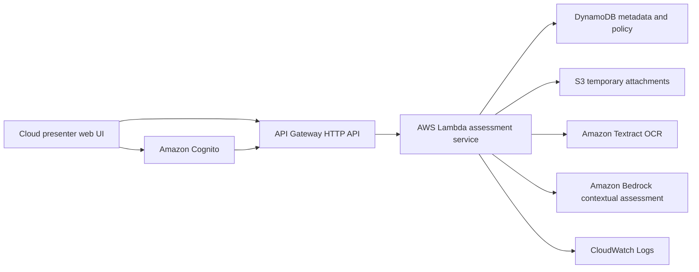

# Threatlock engineering overview

Threatlock is a web-based demonstration of how a conversation-security Android app could behave. The browser UI lets a presenter walk through fictional conversations, inspect drafts and attachments, apply policy, and review incidents. It does **not** read from, send through, or protect other Android apps.

The project has two deliberately separate modes:

| Mode              | What runs                                                                                       | Current state                                                                                                |
| ----------------- | ----------------------------------------------------------------------------------------------- | ------------------------------------------------------------------------------------------------------------ |
| Local walkthrough | Curated scenarios, deterministic policy, recorded contextual results, and browser session state | Runnable without credentials, an AWS account, or runtime network requests                                    |
| Cloud presenter   | Authenticated web UI, API, OCR, contextual inference, and persistent metadata                   | Frontend, backend, and infrastructure are implemented locally; no AWS account has been connected or deployed |

The source is on the [`staging` branch](https://github.com/xt3jas/Threatlock/tree/staging). The repository currently uses React 19, TypeScript, Vite, AWS CDK, the AWS SDK for JavaScript, Vitest, React Testing Library, and Playwright. Local development requires Node.js 22.14 or later; the planned Lambda runtime is Node.js 24.

## Demonstration features

The local walkthrough includes eight fictional scenarios: safe collaboration, social engineering, a credential request, a restricted document, a suspicious screenshot, a likely false positive, manual escalation, and an analysis outage. A presenter can advance incoming messages, edit an outgoing draft, select from six bundled synthetic image/PDF attachments, preview attachments, check a draft, and attempt to send it within the page.

Decisions have distinct sources. Deterministic literal rules and restricted attachment classifications can block sending. Recorded contextual results illustrate AI-style judgments **only** when the scenario, draft, conversation context, and attachment exactly match a curated fixture. Editing any of those inputs does not silently reuse the recorded answer: the UI reports that live AI is unavailable. Warnings can be explicitly overridden; blocks cannot. An outage produces an unscored result rather than a safe verdict.

The rule editor supports up to 50 case-insensitive literal rules, each with a warn or block action. A presenter can stage changes, preview a draft against them without publishing or logging an incident, publish a global revision, and restore earlier content as a new revision. The incident dashboard records metadata such as time, severity, reason, source, direction, fictional persona, and review disposition. It separates session incidents from 12 labelled synthetic-history events and supports filtering and time-based views. Local drafts, rules, and incidents persist in the tab's `sessionStorage`; the walkthrough can be reset.

The main implementation is in [`src/App.tsx`](src/App.tsx), [`src/policy.ts`](src/policy.ts), [`src/session.ts`](src/session.ts), and [`src/Dashboard.tsx`](src/Dashboard.tsx).

## Cloud architecture prepared for deployment

The cloud presenter uses Cognito's authorization-code flow with PKCE. API Gateway checks its JWT before forwarding requests to Lambda. The browser submits conversation context, an outgoing draft, and attachment upload IDs; it cannot supply a trusted classification, policy version, reason code, or model result. The Lambda service loads the published policy, validates the request and attachment ownership, applies deterministic restrictions, extracts supported attachment text with Textract, and uses Bedrock for contextual assessment when appropriate. The model's response is schema-checked; an unavailable or invalid response becomes an explicit unscored result. The browser's **Send** action is a demonstration within the page, not a message to an external service.

Cloud mode supports presenter sign-in, conversation and draft entry, attaching uploads to a context message or the draft, assessments, explicit warning/unscored overrides, blocked-send behavior, staged/published rules, and incident review. It never imports local fixtures or synthetic-history records into cloud data. See [`src/CloudApp.tsx`](src/CloudApp.tsx), [`src/cloudAdapter.ts`](src/cloudAdapter.ts), [`src/cloud-contract.ts`](src/cloud-contract.ts), [`cloud/runtime.ts`](cloud/runtime.ts), and [`cloud/aws.ts`](cloud/aws.ts).

### AWS services and their roles

| Service                     | Prepared role                                                                                                  | Deployment status                                                        |
| --------------------------- | -------------------------------------------------------------------------------------------------------------- | ------------------------------------------------------------------------ |
| AWS CDK / CloudFormation    | Define the stack and enforce an explicit account-integration gate                                              | Offline synthesis passes; deployment is disabled by default              |
| Amazon Cognito              | Invitation-only presenter user pool, hosted login, authorization-code/PKCE client, required TOTP MFA           | Defined, not deployed                                                    |
| Amazon API Gateway HTTP API | JWT authorization, CORS, Lambda routing, and throttling                                                        | Defined, not deployed                                                    |
| AWS Lambda                  | Node.js 24 API for assessments, policy, uploads, and incidents                                                 | Implemented and bundled offline, not deployed                            |
| Amazon DynamoDB             | Published and staged policy, immutable revisions, upload references, assessment cache, metadata-only incidents | Defined, not deployed                                                    |
| Amazon S3                   | Private temporary evidence uploads through presigned POST forms                                                | Defined, not deployed                                                    |
| Amazon Textract             | OCR of supported images and single-page PDFs                                                                   | SDK integration written, not live-tested                                 |
| Amazon Bedrock              | Regional Converse inference with `mistral.ministral-3-8b-instruct`                                             | SDK integration written, model access and output quality not live-tested |
| AWS IAM                     | Lambda access to data services and the selected regional Bedrock foundation model                              | Defined, not deployed                                                    |
| Amazon CloudWatch Logs      | Seven-day Lambda log retention; standard service metrics after deployment                                      | Defined, not active; no staffed alert routing configured                 |
| AWS Budgets                 | Monthly USD 20 cost budget with an alert at 80%                                                                | Defined, not active; alerts do not stop spending                         |
| AWS Amplify Hosting         | Build recipe for the static cloud frontend in [`amplify.yml`](amplify.yml)                                     | Build spec exists; hosting/repository connection is deferred             |

The intended AWS Region is **`ap-south-1` (Mumbai)**. The selected Bedrock model is a direct in-region foundation model, not a cross-region inference profile. The CDK stack restricts Bedrock invocation to that model ARN in the stack Region. AWS account eligibility, model access, promotional-credit coverage, and current costs still need confirmation before deployment.

### Data, security, and failure handling

- Cognito self-sign-up is disabled, TOTP MFA is required, and cloud API routes require a JWT. Browser tokens stay in memory; only the temporary PKCE verifier and state use session storage during login.
- The server enforces request shapes and size limits, derives record ownership from the verified JWT subject, and checks attachment ownership, expiry, MIME type, byte signature, and size. Supported evidence is PNG, JPEG, or single-page PDF under 1 MB; a request may reference up to four attachments.
- Restricted outgoing text or attachment content blocks before contextual inference. An outgoing attachment that cannot be inspected blocks. Missing incoming evidence or unavailable inference produces an unscored result rather than a clear verdict.
- DynamoDB stores policy rules, upload metadata, assessment fingerprints/results, and incident metadata. It does not store conversation bodies, OCR text, attachment bytes, or free-form model explanations. The server does not intentionally log prompts or request bodies.
- Assessment IDs are idempotent: repeating the same request reuses its result; reusing an ID for different content is rejected. Policy publication uses conditional transactional writes to prevent conflicting versions.
- Presigned upload forms expire after five minutes; upload references after 15 minutes. The server attempts to delete referenced owned objects after assessment, and an S3 lifecycle rule is the fallback for abandoned or interrupted uploads. S3 lifecycle deletion is asynchronous.
- API Gateway is configured for 2 requests/second with a burst of 4. Reserved Lambda concurrency is omitted so deployment works on accounts whose concurrency quota is 10, the minimum AWS leaves unreserved. These limits and the AWS Budget alert reduce exposure but are **not** a hard spending cap or a zero-payment guarantee.

The infrastructure definition is [`infra/stack.ts`](infra/stack.ts). No credentials or account-specific endpoints are committed; [`.env.example`](.env.example) contains placeholders only. The CloudFormation deployment gate remains closed until the account, model, and cost review is explicitly completed.

## Verification

As verified on **24 October 2026**, the repository passes:

- 43 unit, component, and infrastructure tests across six test files;
- six Playwright browser tests across desktop and mobile viewports;
- cloud TypeScript checking, offline CDK synthesis with no account lookups, both local and cloud production builds, and Prettier formatting checks.

Run the same checks with `npm test`, `npm run test:e2e`, `npm run typecheck:cloud`, `npm run synth -- --quiet`, `npm run build`, `npm run build:cloud`, and `npm run format:check`. The tests mock AWS ports and inspect synthesized resources. They **do not** establish that Cognito, IAM, Textract, Bedrock, S3 lifecycle, deployed CORS, or billing behave as expected in a real account.

## Remaining integration work

1. Confirm the chosen AWS account can use the required services and the direct Bedrock model in Mumbai, and review current pricing and promotional-credit eligibility against the zero-out-of-pocket goal. AWS Budgets is only an alert mechanism.
2. Decide the real HTTPS presenter origin, Cognito domain prefix, budget-alert address, incident/policy retention period, and operational alert recipients. Review the synthesized template and IAM permissions.
3. After explicit account-integration authorization, bootstrap and deploy the CDK stack with its deployment gate enabled. Connect Amplify Hosting to the repository and configure the three public Vite values from stack outputs.
4. Invite a presenter and validate real sign-in/MFA, API authorization and CORS, upload ownership/expiry and cleanup, Textract OCR, Bedrock output and outages, policy concurrency, incident idempotency, privacy, and actual charges.

The detailed deployment checklist and local run instructions remain in [`README.md`](README.md).
